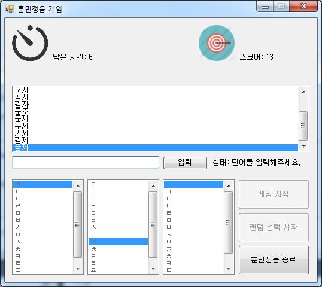

# 훈민정음

[English](README.md)

고른 초성에 맞는 실제 낱말을 시간 안에 입력해 점수를 모으는 초성 게임이다. 초성을 두세 개 정하고 시작하면, 입력한 낱말의 글자마다 초성이 맞는지 확인하고 국립국어원 표준국어대사전 검색 페이지를 파싱해 사전에 있는 낱말인지 판정한다. 낱말을 맞힐 때마다 스코어가 오르고 남은 시간이 다시 채워진다. 학교 과제로 만들었다.

<p>
  
</p>


## 플레이 방법

Releases에서 받아 실행하면 된다. .NET Framework 4.5 가 있어야 하고 낱말 확인에 인터넷 연결을 쓴다.

아래 세 목록에서 첫째, 둘째, 셋째 글자의 초성을 고르고 "게임 시작" 을 누른다. "랜덤 선택 시작" 은 초성을 무작위로 골라 바로 시작한다. 목록에는 ㄱ부터 ㅎ까지 된소리를 뺀 자음 14개가 있고 셋째 목록은 맨 위에 빈칸이 하나 더 있다.

입력란에 낱말을 쓰고 Enter 나 "입력" 을 누른다. 첫째와 둘째 글자의 초성이 맞는 두 글자 낱말은 언제나 받고, 셋째 초성을 골랐으면 셋째 글자까지 맞는 세 글자 낱말도 받는다.

| 결과 | 처리 |
|---|---|
| 사전에 있는 낱말 | 목록에 추가, 스코어 1 증가, 남은 시간 15초로 초기화 |
| 이미 입력한 낱말 | "중복된 단어입니다." |
| 초성이나 글자 수가 맞지 않는 낱말 | "문자 구성을 확인하세요." |
| 사전에 없는 낱말 | "잘못된 단어입니다." |

남은 시간은 1초마다 줄고 사전을 확인하는 동안에는 멈춘다. 0 이 되면 게임이 끝나고 최종 스코어가 뜬다.


## 구현 원리

**초성은 유니코드 위치로 계산한다.** 한글 음절은 `0xAC00` 부터 초성 19개, 중성 21개, 종성 28개의 조합 순서로 놓여 있어서 코드에서 `0xAC00` 을 빼고 28 로, 다시 21 로 나누면 초성 번호가 나온다. 목록에는 된소리가 없으므로 목록 번호를 초성 번호로 바꿀 때 ㄲ, ㄸ, ㅃ, ㅆ, ㅉ 자리를 건너뛴다.

```vb
Public Function WordCheck(ByVal word As Char, ByVal index As Integer) As Boolean
    If (index >= 1) Then index += 1
    If (index >= 4) Then index += 1
    If (index >= 8) Then index += 1
    If (index >= 10) Then index += 1
    If (index >= 13) Then index += 1
    If ((((AscW(word) - &HAC00) \ 28) \ 21) = index) Then Return True
    Return False
End Function
```

**낱말은 사전 검색 결과 페이지를 읽어 확인한다.** 초성이 맞으면 화면에 띄우지 않은 `WebBrowser` 로 국립국어원 표준국어대사전(`stdweb2.korean.go.kr`) 의 검색 페이지를 연다. `DocumentCompleted` 에서 `class` 가 `sword` 인 `td` 를 찾아 그 글이 검색 결과 0건일 때의 문구와 다르면 사전에 있는 낱말로 인정한다. 응답을 기다리는 동안에는 입력란과 타이머를 꺼 둔다.


## 파일

| 경로 | 내용 |
|---|---|
| `source/HunMinJeongEum.sln` | Visual Studio 2013 솔루션 |
| `source/HunMinJeongEum/Form1.vb` | 게임 진행, 초성 판정, 사전 확인 |
| `source/HunMinJeongEum/Form1.Designer.vb` | 폼 디자인 |
| `source/HunMinJeongEum/Resources/` | 시계와 과녁 그림 |
| `docs/screenshots/` | 스크린샷 |
| Releases | 실행 파일 |


## 라이선스

CC BY-NC-ND 4.0 라이선스다. 출처를 밝히면 비상업 용도로 그대로 공유할 수 있고, 수정본 배포와 상업적 이용은 금지한다. 함께 들어 있는 것 중 다른 사람이 만든 라이브러리와 그림·소리·맵은 각자의 권리를 따른다. 자세한 내용은 [LICENSE](LICENSE) 에 있다.
